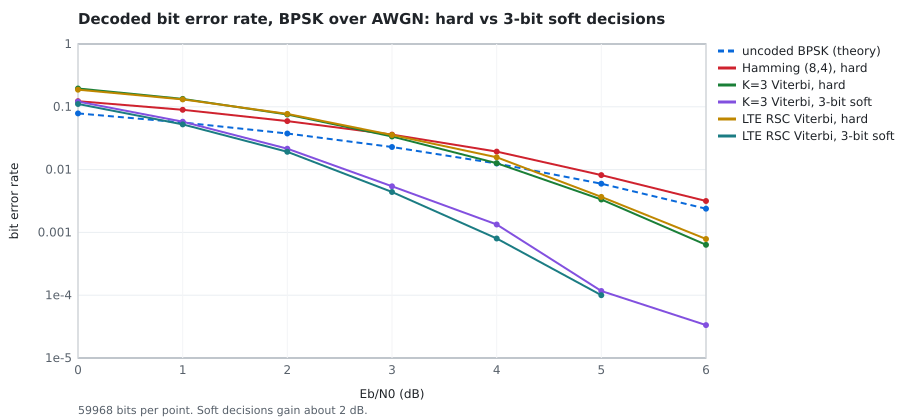
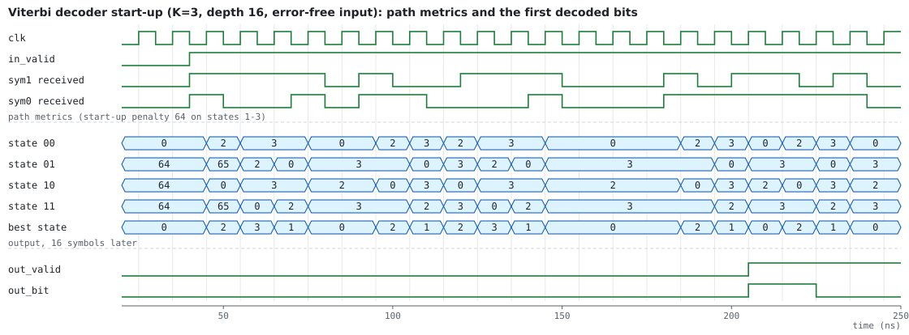

# FEC link with a Viterbi decoder in SystemVerilog

[](https://github.com/r800360/viterbi-fec-sv/actions/workflows/ci.yml)
[](LICENSE)

A complete rate-1/2 forward-error-correction link with a built-in bit-error-rate tester. A PRBS source feeds a
convolutional or Hamming encoder; a channel emulator flips bits; the matching decoder corrects them; a PRBS checker
counts what is left. A host controls it all over a UART. The centerpiece is a parameterized **Viterbi decoder**:
register exchange, hard or 3-bit soft decisions, any rate-1/2 code from K = 3 to K = 7 (including the LTE turbo
constituent code). It matches a Python reference model **bit for bit**.


## Results

| | |
|---|---|
| **Bit-exact decoding** | 9 decoder configurations (2 codes, hard and soft, depths 16–40, clean and noisy channels, random input gaps): every decoded bit equals the reference model's, in Icarus Verilog and Verilator |
| **Whole-system test** | 10 link scenarios driven only through the UART: the hardware's bit, error and flip counters equal the model's prediction exactly (`results/link_*.md`) |
| **Formal** (SymbiYosys) | Hamming SEC-DED guarantees for every word and every 0-, 1- and 2-bit error; encoder ≡ textbook equations, unbounded (PDR); error-free decoding over 40 cycles, with a deliberately off-by-one variant that must fail; PRBS7 period; UART receiver properties and cover |
| **Coding gain** | at a 2 % channel bit error rate: 2.0 × 10⁻² uncoded, 2.8 × 10⁻³ with Hamming (8,4), 7.7 × 10⁻⁴ with K = 3 Viterbi, 6.0 × 10⁻⁴ with the LTE code |
| **Soft decisions** | 3-bit soft decisions gain about 2 dB over hard decisions (BPSK, AWGN) |
| **Survivor depth** | from D ≈ 4K the fixed-latency register-exchange decoder matches full maximum-likelihood decoding |
| **iCE40 HX8K** (nextpnr) | K = 3, D = 32: 334 logic cells at 120 MHz. LTE K = 4, D = 40: 757 cells at 65 MHz. K = 7 (171,133), D = 35: 5 464 cells at 30 MHz |



## How the decoder works

* **The trellis is computed, not written.** Constant functions derive every state's two predecessors and branch
  labels from the code parameters (`K`, `G0`, `G1`, feedback `FB`). One module decodes the feed-forward (7,5)
  code, the recursive systematic LTE code (13,15), and K = 5–7 codes.
* **Branch metrics** are Hamming distances (Q = 1) or sums of 3-bit soft distances (Q = 3).
* **Add-compare-select uses wrap-around metrics.** `a < b` is the sign of `a − b`, which is exact because metric
  spread is bounded, so no normalization logic is needed. Ties go to the lower predecessor, so the hardware is
  deterministic and the model can match it exactly.
* **Register exchange.** Each state carries the input bits of its survivor path. After D symbols the survivors
  have merged, and the oldest bit of the best state's survivor is the output. The best state comes from a log-depth
  comparator tree: replacing a linear scan raised Fmax from 31 to 65 MHz for the 8-state code.

Details, the register map and the trade-offs against trace-back: [docs/DESIGN.md](docs/DESIGN.md). Every check and
how each tool is run: [docs/VERIFICATION.md](docs/VERIFICATION.md).



## Reproduce

Toolchain (pinned in [`scripts/install-tools.sh`](scripts/install-tools.sh)): Ubuntu 26.04 with Icarus Verilog
12.0, Verilator 5.032, Yosys 0.52, SymbiYosys 0.52 with Z3 4.13, nextpnr-ice40 0.9, Graphviz and Python 3. The
model needs nothing beyond the Python standard library.

```bash
docker build -t viterbi-fec-sv .
docker run --rm -u "$(id -u):$(id -g)" -v "$PWD":/work viterbi-fec-sv make all check   # about 15 minutes
```

| Target | What it runs |
|---|---|
| `lint` | `verilator --lint-only -Wall` on the whole design |
| `sim` | every testbench in both simulators, and the link counters against the model |
| `formal` | every SymbiYosys task, each with its expected outcome |
| `ber` | BER curves from the bit-exact model (`results/ber_*.csv`, `depth.csv`) |
| `ppa` | yosys + nextpnr for 10 decoder configurations (`results/ppa.csv`) |
| `figures` | every chart, trellis, block and timing diagram in `figures/` |
| `check` | fail if any result or figure differs from the committed version |

`results/SUMMARY.txt` lists every check. CI runs `make all check` on every push and uploads `results/` and
`figures/`.

## Repository map

```
rtl/      conv_encoder, conv_encoder_prog, viterbi_decoder, hamming84, prbs, bsc_channel, uart, fec_link_top
tb/       tb_viterbi (vector-driven, bit-exact), tb_blocks (encoders, Hamming, PRBS, UART), tb_link (system, via UART)
model/    fec.py (bit-exact reference), gen_vectors.py, link_model.py, ber_sweep.py
formal/   fec_formal.sv (harnesses), fec.sby (tasks)
tools/    flow.sh (the flow), ppa_sweep.sh, figures.py, check_link.py, svgchart.py, vcd2svg.py, pnr_summary.py
docs/     DESIGN.md, VERIFICATION.md, block_diagram.dot, waves/ (timing-diagram specifications)
results/  every log, CSV and summary;   figures/  every SVG
```

Origin: the decoder started as a university digital-design project (a trace-back Viterbi decoder for one fixed
code), and several blocks come from smaller exercises (LFSR, UART receiver, programmable convolutional encoder,
Hamming codes). This repository is an independent re-design: generic codes, register exchange, soft decisions, a
bit-exact model, and the link around them.

MIT License, © 2026 Rohan Sachdeva.
