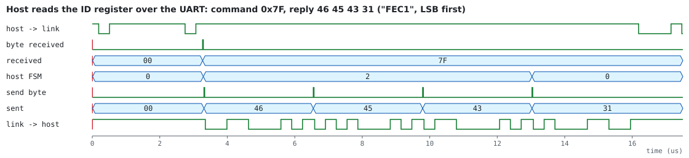

# Design

The link moves one data bit per clock: a PRBS-15 source, a rate-1/2 encoder, a channel emulator that flips bits,
the matching decoder, and a PRBS checker that counts the errors left after decoding. A host configures it and reads
the counters over a UART. Every block is a separate module with its own tests.

| Module | File | What it does |
|---|---|---|
| `conv_encoder` | [rtl/conv_encoder.sv](../rtl/conv_encoder.sv) | rate-1/2 encoder for any constraint length, feed-forward or recursive systematic, polynomials as parameters |
| `conv_encoder_prog` | [rtl/conv_encoder_prog.sv](../rtl/conv_encoder_prog.sv) | feed-forward encoder whose two polynomials are loaded at run time |
| `viterbi_decoder` | [rtl/viterbi_decoder.sv](../rtl/viterbi_decoder.sv) | register-exchange Viterbi decoder for the same codes, hard or soft decisions |
| `hamming84_*` | [rtl/hamming84.sv](../rtl/hamming84.sv) | (8,4) extended Hamming SEC-DED codec and its serial link adapters |
| `prbs_gen`, `prbs_check` | [rtl/prbs.sv](../rtl/prbs.sv) | ITU-T O.150 PRBS generator and a checker that counts each error once |
| `bsc_channel` | [rtl/bsc_channel.sv](../rtl/bsc_channel.sv) | binary symmetric channel (xorshift32) or fixed error patterns |
| `uart_receiver`, `uart_transmitter`, `baud_tick` | [rtl/uart.sv](../rtl/uart.sv) | 8N1 UART; the receiver synchronizes `rx` and samples mid-bit |
| `fec_link_top` | [rtl/fec_link_top.sv](../rtl/fec_link_top.sv) | the link, the host protocol and the register file |

## Codes

Polynomials use the conventional octal notation with D^0 in the most significant bit (7 = 1 + D + D²).

| Code | Parameters | Free distance | Notes |
|---|---|---:|---|
| K = 3 (7,5) | `K=3, G0=7, G1=5` | 5 | the textbook code; feed-forward, non-systematic |
| LTE turbo constituent | `K=4, FB=13, G1=15` | 6 | recursive systematic: output = {parity, input}; the register holds feedback bits `w = d ^ ^(FB & s)` |
| (8,4) extended Hamming | P4 = D4^D3^D2, P2 = D4^D3^D1, P1 = D4^D2^D1, P0 = overall parity | 4 | block code: corrects 1, detects 2 errors per 8 bits |

All three are rate 1/2, so the link sends one 2-bit symbol per data bit whatever the code, and their error rates
can be compared at the same channel bit error rate.

## The Viterbi decoder

**Trellis from parameters.** State `ns` is entered from `p0 = {ns[K-3:0], 0}` and `p1 = {ns[K-3:0], 1}`; the bit
shifted in is `w = ns[K-2]`, and the input bit is `w` (feed-forward) or `w ^ ^(FB & p)` (recursive). Constant
functions compute every branch label at elaboration, so one module decodes any rate-1/2 code from K = 3 to 7.

**Branch metrics.** A received symbol is two Q-bit values, 0 for a sure 0 up to 2^Q − 1 for a sure 1. The metric of
a branch label bit b is `r` if b = 0 and `2^Q − 1 − r` if b = 1, summed over the two bits. Q = 1 is hard-decision
Hamming distance; Q = 3 is 3-bit soft decision.

**Add-compare-select with wrap-around metrics.** Path metrics are W-bit (`W = Q + 8`) and are never normalized: `a <
b` is decided by the sign bit of `a − b`, which is exact while every metric is within 2^(W−1) of every other. The
spread of a K-state trellis is bounded (about 2·(2^Q − 1)·(K − 1)), so that always holds, and no normalization
logic or comparison against a threshold is needed. Ties go to `p0`, so the hardware is deterministic and the model
can match it bit for bit.

**Register exchange.** Every state keeps a D-bit survivor register holding the input bits of its best path. Each
symbol, a state copies the survivor of its winning predecessor shifted by one, with the branch's input bit appended.
After D symbols all survivors have merged with high probability, and the oldest bit of the best state's survivor is
the decoded bit. Compared with trace-back through a survivor memory:

| | register exchange (this design) | trace-back with block memories |
|---|---|---|
| latency | D symbols, fixed | a few times the trace-back length |
| storage | S × D flip-flops, plus S × D muxes | S × L bits of RAM per bank, several banks |
| control | none | bank rotation, trace-back state machines, output reversal |
| scales well for | small K (S = 4 … 64) | large K, long survivor depth |

The depth sweep ([figures/depth.svg](../figures/depth.svg)) shows the classic rule: from D ≈ 4–5 K the fixed-latency
decoder matches full maximum-likelihood decoding with unbounded trace-back.

## Channel emulator

`mode 1` is a binary symmetric channel: one xorshift32 draw per symbol, low half for bit 0 and high half for bit 1,
each flipped when below `threshold` (probability threshold / 65536). `mode 2` repeats a pattern (`burst` bad
symbols at the start of every `period`, bits chosen by `mask`) for structured tests: isolated errors, pairs, bursts
on one bit or both. No error is injected during the first `holdoff` symbols after a restart, so the PRBS checker
can lock on clean data, as a real link would during a preamble.

## Host protocol and registers

8N1 at `CLKS_PER_BIT` clocks per bit (434 for 115 200 baud from 50 MHz). A command byte `{write, address[6:0]}`;
a write is followed by 4 data bytes, a read is answered with 4 bytes, least significant first.

| Address | Register | Fields |
|---|---|---|
| 0x00 | CTRL | [0] run, [2:1] code (0 uncoded, 1 K=3, 2 LTE, 3 Hamming), [3] clear: restart the datapath, zero the counters |
| 0x01 | CH_CFG | [1:0] mode, [3:2] error mask, [31:16] threshold |
| 0x02 | CH_PATTERN | [15:0] period, [31:16] burst length |
| 0x03 | CH_HOLDOFF | [15:0] clean symbols after a restart (default 256) |
| 0x04 | CH_SEED | channel random seed (0 selects a fixed default) |
| 0x05 | G_POLY | [6:0] polynomial (D^0 in bit 6), [9:8] load generator 1 / 0 of the programmable encoder |
| 0x10, 0x11 | BITS, ERRORS | PRBS checker counters (after lock) |
| 0x12 | FLIPS | bits the channel inverted |
| 0x13 | STATUS | [0] checker locked, [1] running |
| 0x14, 0x15 | HAM_CORRECTED, HAM_DOUBLE | Hamming decoder events |
| 0x16 | UART_FRAME_ERRORS | framing errors seen by the host receiver |
| 0x7F | ID | "FEC1" |

