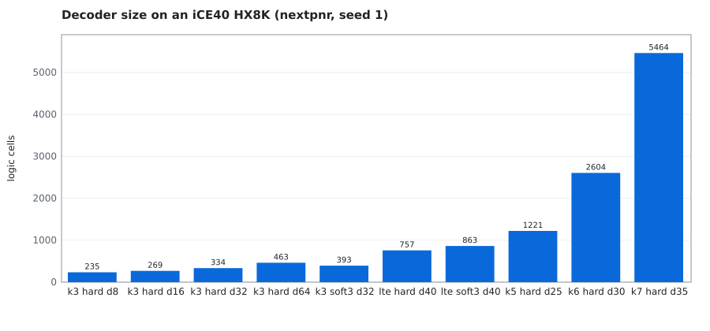
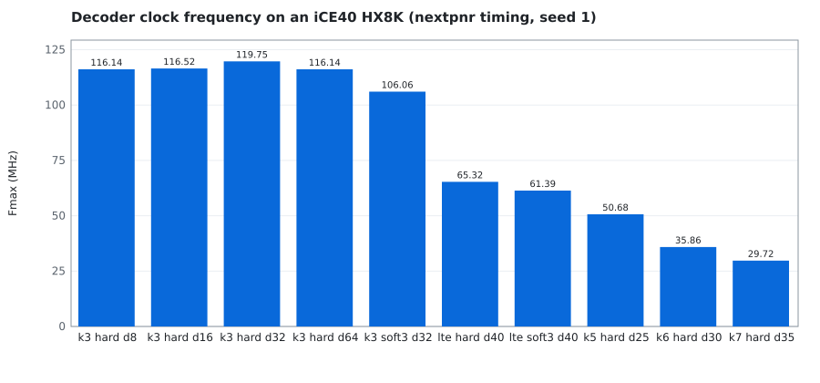

# Verification

Every check below runs in `make all` ([tools/flow.sh](../tools/flow.sh)) and is listed with its expected outcome in
[results/SUMMARY.txt](../results/SUMMARY.txt). Logs are normalized (no run times or absolute paths), and `make check`
fails if a rerun changes any committed result or figure.

## The reference model

[model/fec.py](../model/fec.py) implements the encoders, the register-exchange decoder (`viterbi_re`), a full
maximum-likelihood decoder with unbounded trace-back (`viterbi_ml`), the Hamming codec, the PRBS generators and the
channel's xorshift32. `viterbi_re` follows the RTL exactly: W-bit wrap-around metrics, ties to the lower
predecessor, best state by lowest index on ties, output timing. So the testbenches can compare every bit, not just a
bit error rate. Sanity checks of the model itself: error-free streams decode to the input, and the K = 3 worked
example (16 received symbols) decodes to the same message as the exhaustive maximum-likelihood search.

## Simulation (Icarus Verilog 12.0 and Verilator 5.032)

| Testbench | What it checks |
|---|---|
| [tb/tb_viterbi.sv](../tb/tb_viterbi.sv) | streams `build/vectors/dec_<config>.hex` (written by [model/gen_vectors.py](../model/gen_vectors.py)) into the decoder, with random idle cycles in Icarus, and compares every output bit with the model. 9 configurations: K = 3 hard with depth 16 (clean) and 32 (5 % and 10 % BSC); LTE hard with depth 40 (clean, 5 % BSC); K = 3 and LTE with 3-bit soft decisions at Eb/N0 = 2 dB; K = 3 soft with depth 24 at 0 dB; the worked example |
| [tb/tb_blocks.sv](../tb/tb_blocks.sv) | encoders against the model's vectors (2000 bits each), including reprogramming the programmable encoder in mid-stream; the Hamming decoder on all 16 words × every error pattern of weight 0, 1 and 2; PRBS7 and PRBS9 periods; the checker counting every injected error once; UART loopback of all 256 bytes, a framing error and a glitch |
| [tb/tb_link.sv](../tb/tb_link.sv) | the whole link through its UART: ID register, register read-back, programmable encoder loading, then 10 scenarios (4 codes on a 2 % BSC, 2 codes on 5 %, 4 fixed error patterns). Each prints its counters; [tools/check_link.py](../tools/check_link.py) compares them with [model/link_model.py](../model/link_model.py) |

Commands (see `sim_iv` and `sim_vl` in flow.sh):

```bash
iverilog -g2012 -Itb -P<tb>.K=3 ... -s tb_viterbi -o x.vvp tb/tb_viterbi.sv rtl/viterbi_decoder.sv
vvp -n x.vvp +VEC=build/vectors/dec_<config> +N=3000 +GAPS
verilator --binary --timing -Itb -Wno-fatal -Wno-lint -Wno-style -GK=3 ... --top-module tb_viterbi ...
```

## Formal (SymbiYosys 0.52, Yosys 0.52, Z3 4.13, ABC)

| Task | Engine | Property | Expected |
|---|---|---|---|
| `hamming` | smtbmc (k-induction) | for every data word and error pattern: weight ≤ 1 decodes correctly, weight 1 is flagged corrected, weight 2 is flagged double | PASS |
| `encoder` | abc pdr | `conv_encoder` for (7,5) and for the LTE code equals the textbook equations written independently, from reset, unbounded | PASS |
| `viterbi` | abc bmc3 | encoder → decoder, K = 3, D = 8, any input: every decoded bit equals the input D + 1 accepted bits earlier (40 cycles) | PASS |
| `viterbi_offbyone` | smtbmc | the same with the alignment off by one: proves the check above is not vacuous | FAIL |
| `prbs7` | smtbmc | from seed 1, the PRBS7 state returns to 1 after exactly 127 bits and not before | PASS |
| `uart` | smtbmc (k-induction) | any line waveform: `valid` lasts one cycle, `data` changes only with `valid`, `valid` and `frame_err` never together | PASS |
| `uart_cover` | smtbmc cover | a byte 0xA5 can be received | PASS |

## Implementation

[tools/ppa_sweep.sh](../tools/ppa_sweep.sh): `yosys synth_ice40` with the decoder as top, then
`nextpnr-ice40 --hx8k --package ct256 --seed 1 --freq 48 --timing-allow-fail --report`, summarized by
[tools/pnr_summary.py](../tools/pnr_summary.py) into [results/ppa.csv](../results/ppa.csv).




## Lint

`verilator --lint-only -Wall -Wno-DECLFILENAME` on the whole design: no warnings.
